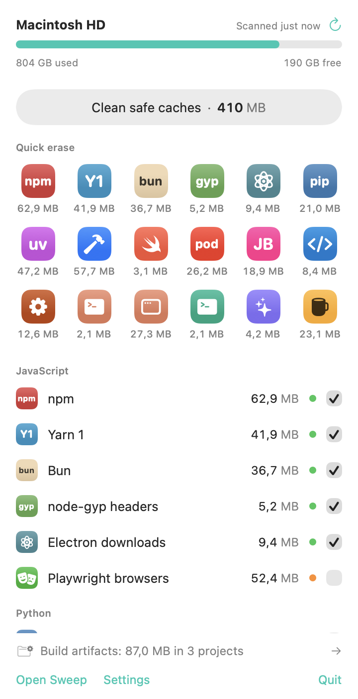
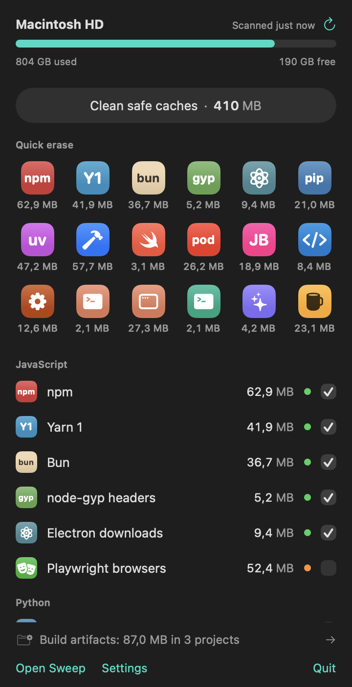
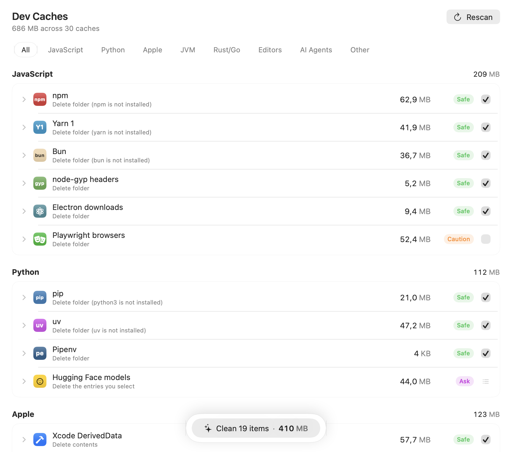
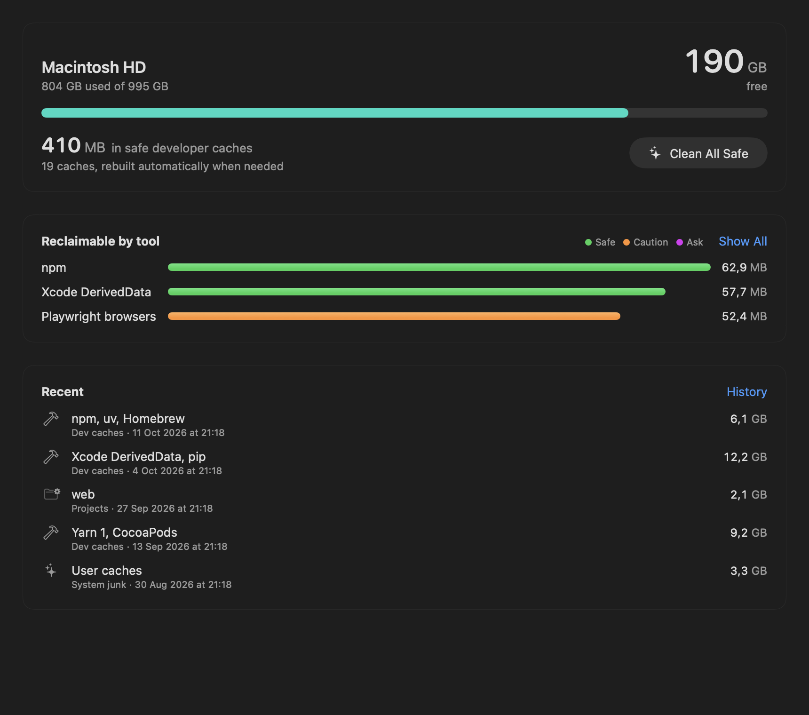

<p align="center">
  
</p>

<h1 align="center">Sweep</h1>

<p align="center">
  A native macOS cleaner for developers. One click from the menu bar frees npm, Yarn, pip, uv, Xcode,<br>
  Docker, Homebrew and AI-agent leftovers, and nothing outside a known cache can ever be deleted.
</p>

<p align="center">
  
  &nbsp;&nbsp;
  
</p>

Sweep is a SwiftUI app for macOS 14 and later, with a command-line tool that shares the same engine. It has no
account, no telemetry, no payments and no update server. It talks to nothing but the tools already on your Mac.

> [!WARNING]
> Sweep deletes files, and it is young. Read [Status](#status) before pointing it at a machine you care about,
> and start with the [fixture home](#try-it-without-touching-your-mac) or `--dry-run`.

## What it does

**Menu bar**

- **One-click clean.** A single button cleans every Safe-tier cache; the number on it is the sum of the ticked rows.
- **Quick erase.** A grid of icons, one per cache that is safe to erase. Click one to erase just that cache;
  clicks queue while another runs.
- **Live scan.** Each tool gets its own row and loading state, so sizes appear as they arrive.
- **Global hotkey** (⌃⌥⌘K by default), a right-click menu, notifications, and optional scheduled cleans.

**Main window**

| Tool | What it is for |
| --- | --- |
| Overview | Disk bar, reclaimable space per tool, recent operations |
| Dev Caches | All 56 rules, including the ones you pick entry by entry |
| Projects | `node_modules`, `target`, `.venv`, `.next`, DerivedData and friends, per project, oldest first |
| Clean | App caches, logs, crash reports, browser caches, old installers, the Trash |
| Uninstall | Apps with their leftovers, Homebrew casks, `.pkg` receipts, orphaned support files |
| Optimize | Flush DNS, rebuild Launch Services, reindex Spotlight, compact databases, and more |
| Analyze | A treemap of any folder or volume, with largest and oldest files |
| Status | Live CPU, memory, GPU, disk, network, battery, and a process table |
| History | Every operation, and space freed per week |

<p align="center">
  
  
</p>

## What it cleans

Every rule asks the tool where its cache really is before falling back to a default path, and runs the tool's
own clean command when there is one (`npm cache clean --force`, `go clean -cache`, `docker builder prune -f`).

| Group | Rules |
| --- | --- |
| JavaScript | npm, Yarn 1, Yarn Berry, pnpm, Bun, Deno, node-gyp, Electron, Playwright, Puppeteer, Cypress |
| Python | pip, uv, Poetry, Pipenv, Conda, pyenv, pre-commit, Hugging Face models |
| Apple | DerivedData, Archives, device support, simulators and runtimes, SwiftPM, CocoaPods, Carthage |
| JVM | Gradle, Maven, Android emulator images |
| Rust / Go | Cargo registry, Go build cache, Go module cache |
| Containers | Docker build cache, stopped containers, unused images, volumes |
| Editors | JetBrains caches of versions no longer installed, VS Code and Cursor caches |
| AI agents | Claude Code and Codex temp files, shell snapshots, checkpoints, old sessions, worktrees; Gemini CLI, opencode, Goose, Copilot CLI, Aider, Cline, Roo Code |
| Other | Homebrew, Composer, RubyGems, Ollama models |

Each rule has a risk tier that decides how it can be cleaned:

| Tier | Meaning | One-click |
| --- | --- | --- |
| 🟢 Safe | Rebuilt automatically; the only cost is a re-download or rebuild | Ticked by default |
| 🟠 Caution | Rebuilt slowly, or breaks offline work until rebuilt | Listed, unticked, confirmed first |
| 🟣 Ask | May hold things you chose or made: models, archives, volumes, worktrees | Never; picked entry by entry |

Agent sessions are judged by age: an entry is only offered when nothing inside it has changed for the rule's
number of days, and that is checked again right before deleting, so an open or resumed session is left alone.

## Safety model

Sweep deletes only what a rule explicitly names. Everything else is denied by default, and the checks live in
the engine, so the menu bar, the main window and the CLI all get them.

1. **Allowlist first.** A path is deletable only under a location a rule resolved to.
2. **Hard deny list.** `/System`, `/usr`, `/Applications` (outside Uninstall), your home folder, Documents,
   Desktop, Pictures, Movies, Music, iCloud Drive, `~/.ssh`, `~/.gnupg`, Keychains, any `.git` folder, and any
   folder that is itself a git working tree.
3. **Symlinks are never followed** and never deleted as targets. Paths are checked again after `realpath`.
4. **Re-check before acting.** Identity and owner are re-read right before a delete; a folder swapped since the
   scan is skipped.
5. **Running-app guards.** DerivedData waits while Xcode runs; editor and browser caches wait for their apps.
6. **Preview always.** Every action shows what will go and how much first; the CLI has `--dry-run` everywhere.
7. **Ledger.** Every operation is appended to `~/Library/Logs/Sweep/operations.jsonl`.
8. **Narrow root helper.** Admin work is an enum of named tasks. No raw path or shell string crosses to root.

The test suite enforces this with fixture homes, symlink traps, git-tracked build folders, and a property test:
for random rules over random trees, no file outside the allowlist is ever removed.

## Requirements

- macOS 14 Sonoma or later (Liquid Glass on macOS 26 and later, system materials before that)
- Xcode 26 or later to build
- Apple Silicon is what it is developed on; Intel should work but is untested

## Build

Open `Sweep.xcodeproj` and run the `Sweep` scheme, or from the terminal:

```bash
Scripts/build-app.sh
```

The app lands in `build/DerivedData/Build/Products/Debug/Sweep.app`. The project signs to run locally; choose
your own team under Signing & Capabilities if you want the root helper to register.

## Try it without touching your Mac

With `SWEEP_HOME` set, the app and the CLI see only that folder, run no real tools, and skip the login item,
hotkey and helper. A script builds a throwaway home full of fake caches, projects, apps and agent sessions:

```bash
Scripts/make-fixture.sh /tmp/sweep-home
```

```bash
SWEEP_HOME=/tmp/sweep-home build/DerivedData/Build/Products/Debug/Sweep.app/Contents/MacOS/Sweep
```

Clean anything you like in there, then rerun the script to reset it.

## Command line

The `sweep` binary is bundled in `Sweep.app/Contents/Helpers`; Settings → Advanced links it into
`/usr/local/bin`. During development, `swift run --package-path SweepKit sweep …` works too.

```bash
sweep scan [--json] [--all] [ids…]
sweep clean --tier safe [--dry-run] [--trash] [--yes]
sweep clean npm pip xcode-deriveddata
sweep purge ~/Projects --older-than 30d [--dry-run] [--permanent] [--yes]
sweep status [--json]
sweep history [--json]
```

Destructive commands print what they will remove and ask first; in a script, pass `--yes`. Sizes marked
"up to" belong to prune-style commands, where the tool decides what is unused.

## Add your own rule

Drop a JSON file into `~/Library/Application Support/Sweep/catalog.d/`. No rebuild needed.

```json
{
  "id": "mytool",
  "name": "My tool",
  "group": "other",
  "risk": "safe",
  "tint": "#7C6CF0",
  "monogram": "mt",
  "locate": [{"command": ["mytool", "cache", "dir"]}, {"paths": ["~/.mytool/cache"]}],
  "clean": {"type": "command", "command": ["mytool", "cache", "clean"]}
}
```

`locate` steps are tried in order: a command to ask the tool, an `env` variable, then default `paths` (with `~`,
`*` and `{a,b}`). `clean` is one of `delete`, `deleteChildren`, `command`, or `select`; `olderThanDays` limits
`deleteChildren` and `select` to entries untouched that long. The 56 built-in rules in
[`catalog.json`](SweepKit/Sources/SweepKit/Resources/catalog.json) are the reference.

## Project layout

```
Sweep.xcodeproj     the app, the bundled CLI and the root helper
Sweep/              app sources: menu bar, main window, Settings, hotkey, App Intents
SweepKit/           one Swift package: engine, feature modules, their views, and the tests
SweepHelper/        entry point of the privileged helper
Launchd/            launchd plists embedded in the app
Scripts/            build, fixture, icon and test helpers
docs/               the product spec and screenshots
```

Inside `SweepKit`, the `SweepKit` target is the engine: Catalog → Resolver → Sizer → Guard → Executor → Ledger,
plus the project scanner. `SweepMetrics`, `SweepAnalyze`, `SweepJunk`, `SweepUninstall` and `SweepOptimize` are
the feature engines; `StatusUI`, `AnalyzeUI`, `JunkUI`, `UninstallUI` and `OptimizeUI` are their views;
`SweepDesign` holds the shared look. The design is described in [docs/SPEC.md](docs/SPEC.md).

## Development

```bash
Scripts/t.sh                  # all tests, compact output
Scripts/t.sh SweepKitTests    # one target
```

Tests build fixture homes in the temp directory and never touch the real one. Debug builds can also render
every screen to PNG, which is how the screenshots here were made:

```bash
SWEEP_HOME=/tmp/sweep-home build/DerivedData/Build/Products/Debug/Sweep.app/Contents/MacOS/Sweep --snapshot /tmp/sweep-shots
```

## Status

Sweep is early. Honest state of things:

- **Solid:** the engine and its safety checks, the catalog, the CLI, and the clean, purge and uninstall flows,
  all covered by tests and exercised end to end against fixture homes.
- **Lightly tested:** the app's windows on real hardware, across macOS versions.
- **Not yet proven:** the root helper (`SMAppService` registration, the XPC round trip) and the password-prompt
  fallback have unit tests but have not been run for real. Dock tile removal and notification-history pruning
  have only run against fakes.
- **Unverified paths:** the rules for agents other than Claude Code and Codex come from documentation and
  memory. A wrong path shows as "not found" and deletes nothing.
- **Icons** are drawn monograms and SF Symbols, not brand logos. An image named `glyph-<id>` in the asset
  catalog replaces a tile.

## Contributing

Issues and pull requests are welcome. Two things keep the project trustworthy:

- **New rules** need a risk tier you can defend and, where the tool has one, its own clean command. Check the
  path and command against the tool's current documentation, and say in the pull request how you verified it.
- **Anything that deletes a user's files** must go through `GuardedRemover` and come with a fixture test.
  Feature modules never call `FileManager.removeItem` or `trashItem` on them directly.

Run `Scripts/t.sh` before opening a pull request.

## Credits

Cache rules and safety lists are informed by [Mole](https://github.com/tw93/Mole) (MIT) by tw93, the CLI behind
Kivo. Sweep has its own Swift engine and shares no code with it.

## License

No licence has been chosen yet. Until a `LICENSE` file is added, the code is not licensed for reuse.
